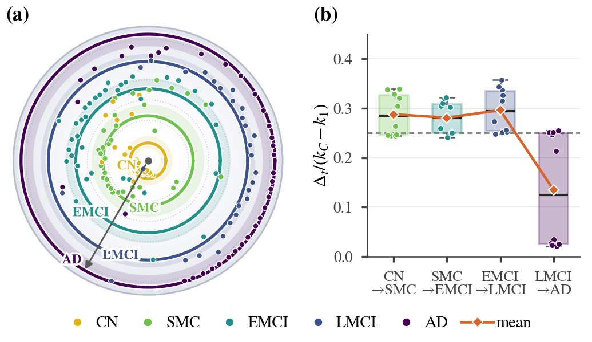

# HYPERING
*Hyperbolic ring model for Alzheimer's disease staging from resting-state fMRI connectivity.*

---

## Overview

**Hypering** embeds a functional-connectivity (FC) matrix on the Poincaré ball and assigns
each disease stage a learned concentric ring, ordered

**CN < SMC < EMCI < LMCI < AD**

The geodesic distance from the origin acts as a continuous severity score, and the predicted
stage is the nearest ring. This repository provides the model code, pretrained weights,
preprocessing, inference and plotting scripts (training code is not included).

---

*(a) Test-set embeddings on the Poincaré disk with the learned stage rings. (b) Normalised gaps between adjacent rings over 10 training runs; the dashed line marks equal spacing.*

## Features
🔹 Pretrained models (3 seeds) trained on ADNI rs-fMRI, 5 stages  
🔹 Preprocessing from Destrieux-atlas FC matrices (`.npy` / `.txt` / `.csv`)  
🔹 Per-scan severity score, stage affinities, predicted stage and 10-d embedding  
🔹 Single-model or seed-ensemble prediction  
🔹 Disk visualization of embeddings and stage rings  
🔹 Lightweight, runs on CPU  

---

## Installation

```bash
git clone https://github.com/xianzhushao/Hypering.git
cd Hypering

# Create a virtual environment (recommended)
python3 -m venv venv
source venv/bin/activate

# Install dependencies
pip install -r requirements.txt
```

## CLI Usage
```bash
# FC matrices -> model input
python preprocess.py --input my_fc_matrices/ --output features.csv

# Stage prediction with one model
python predict.py --input features.csv --output pred.csv --model checkpoints/seed_042

# Ensemble of all seeds
python predict.py --input features.csv --output pred.csv --model checkpoints

# Plot embeddings and stage rings
python visualize.py --pred pred.csv --model checkpoints/seed_042 --output disk.png

# Reproduce the paper figure
python figures/plot_fig_combine.py
```

## Python API

```python
import torch
from hypering import load_pretrained

model = load_pretrained("checkpoints/seed_042")
out = model(torch.randn(4, 10878))  # preprocessed FC edge vectors
out["rho"], out["pred"], model.radii  # severity score, stage index, ring radii
```

## Acknowledgments
* [ADNI](https://adni.loni.usc.edu) for the imaging data (not redistributed here)
* [geoopt](https://github.com/geoopt/geoopt) for hyperbolic manifold operations
* [PyTorch](https://pytorch.org/) for model implementation

## Citation
If you find this code useful for your research, please cite our paper:
```
@inproceedings{TODO2027ring,
  title={TODO},
  author={TODO},
  booktitle={2027 IEEE International Symposium on Biomedical Imaging (ISBI)},
  year={2027}
}
```
